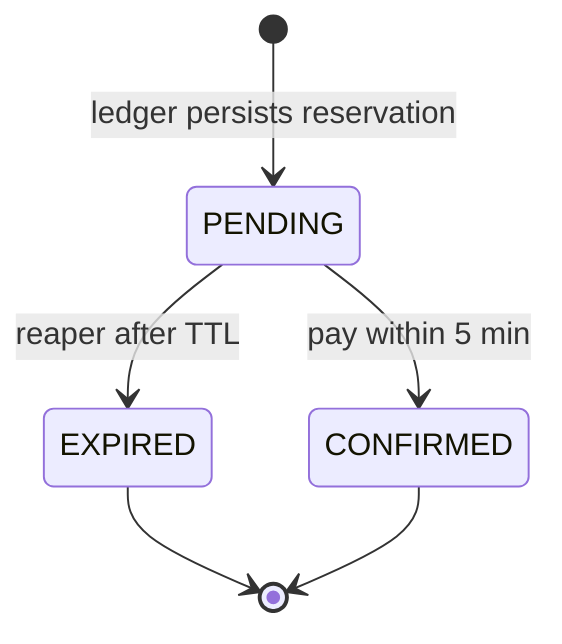
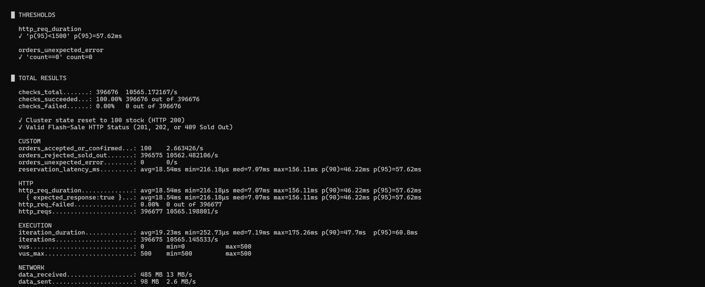

<div align="center">

# ⚡ Atomix
### Polyglot High-Concurrency Flash-Sale & Inventory Reservation Engine

[](https://www.typescriptlang.org/)
[](https://spring.io/projects/spring-boot)
[](https://redis.io/)
[-FF6600?style=for-the-badge&logo=rabbitmq&logoColor=white)](https://www.rabbitmq.com/)
[](https://www.postgresql.org/)
[](https://www.docker.com/)

*A distributed systems engineering project demonstrating how to handle 396,000+ flash-sale requests (~10,565 req/s sustained throughput) competing for limited inventory with a 7.07ms median latency and zero overselling, backed by an idempotent, self-healing reservation pipeline with explicit failure semantics.*

</div>

---

## 🎯 The Engineering Problem

In standard CRUD applications, purchasing an item follows a simple database sequence:
1. `SELECT available_stock FROM inventory WHERE item_id = $1;`
2. Check if `available_stock > 0` in application memory.
3. `UPDATE inventory SET available_stock = available_stock - 1 WHERE item_id = $1;`

Under normal traffic, this works fine. During a **flash sale** (e.g., thousands of users clicking "Buy Now" within the same window for 100 items), this pattern suffers from severe failure modes:
* **Time-of-Check to Time-of-Use (TOCTOU) Race Conditions:** Hundreds of concurrent threads read `available_stock > 0` simultaneously before any `UPDATE` commits, leading to massive overselling.
* **Database Connection Pool Exhaustion:** Opening thousands of synchronous ACID transactions or holding pessimistic row locks (`SELECT ... FOR UPDATE`) saturates PostgreSQL CPU and exhausts HikariCP connection pools.

**Atomix** solves this by decoupling **high-speed edge reservation** from **durable ledger persistence** using a multi-tiered L1/L2 caching strategy, atomic Redis Lua scripting, and asynchronous AMQP backpressure.

Splitting the work across Redis, RabbitMQ and PostgreSQL creates a second class of problems: a reservation must survive the gaps *between* those systems. Atomix treats those gaps as first-class design concerns: **publisher confirms, a compensating undo, an outbox, idempotent consumers, dead-lettering, and a drift detector** keep the three stores consistent when brokers restart, messages are redelivered, or workers crash (see [Consistency Model & Failure Semantics](#-consistency-model--failure-semantics)).

---

## 🏗️ System Architecture

```text
                    [ 396,677 Flash-Sale Requests / 500 Concurrent VUs ]
                                              │
                                              ▼
                     ┌─────────────────────────────────────────────────┐
                     │ Nginx API Gateway (:80)                         │
                     │ • epoll / 16,384 worker_connections             │
                     │ • 1,024 persistent upstream keepalive sockets   │
                     └────────────────────────┬────────────────────────┘
                                              │
                                              ▼
┌───────────────────────────────────────────────────────────────────────────────────┐
│ STAGE 1: Clustered Edge Gatekeeper (Node.js 24 + Express 5 + PM2 `-i max`)        │
│                                                                                   │
│  1. L1 In-Memory Circuit Breaker (Per-Worker V8 RAM Cache, 250ms TTL):            │
│     • Absorbs post-sellout traffic floods in ~216µs with zero Redis network I/O   │
│  2. L2 Atomic Redis Lua Script (`EVALSHA`, Single-Threaded Execution):            │
│     • Idempotency key -> `stock > 0` -> one-per-user `buyers` Set                 │
│     • Decrements `stock`, records buyer + reservationId in one atomic step        │
│  3. Confirmed Publish to RabbitMQ (`mandatory`, persistent, 2s confirm timeout):  │
│     • Rejected -> undo + 503  |  Unknown -> Redis outbox (never undone)           │
└─────────┬───────────────────────────────────────────────────────────────┬─────────┘
          │                                                               │
          │ (Stock == 0 or Duplicate Buyer)                               │ (Stock Reserved!)
          ▼                                                               ▼
┌───────────────────────────┐                           ┌───────────────────────────────────┐
│ HTTP 409 Fast-Fail        │                           │ HTTP 202 Accepted (Reservation ID)│
│ (Zero PostgreSQL Load)    │                           └───────────────────────────────────┘
└───────────────────────────┘                                             │
                                                                          ▼
                                                        ┌───────────────────────────────────┐
                                                        │ STAGE 2: Asynchronous AMQP Broker │
                                                        │ (RabbitMQ 4 — Durable Exchange)   │
                                                        │  • Buffers burst traffic          │
                                                        │  • Publisher confirms + mandatory │
                                                        │  • Backpressure + DLX/DLQ         │
                                                        └─────────────────┬─────────────────┘
                                                                          │ (prefetch = 25)
                                                                          ▼
┌───────────────────────────────────────────────────────────────────────────────────┐
│ STAGE 3: Core Transaction Ledger (Java 25 + Spring Boot 4 + PostgreSQL 18)        │
│                                                                                   │
│  • 4-8 @RabbitListener threads drain the queue (prefetch 25; protects HikariCP)   │
│  • Idempotent: unique `idempotency_key` + check, so redelivery is safe            │
│  • Inventory guard: `UPDATE ... available = available - 1 WHERE available > 0`    │
│  • Writes `PENDING` reservation; 5-min payment window starts at the 202           │
│  • Failures: 3 retries -> DLX -> DLQ (Redis refund) -> parking lot                │
│  • Updates Redis telemetry -> streamed to React UI via Node.js SSE (250ms)        │
└─────────────────────────┬───────────────────────────────────────────────┬─────────┘
                          │                                               │
        (Payment Confirmed within 5m)                   (TTL Expired / Unpaid Order)
                          ▼                                               ▼
        ┌───────────────────────────────────┐           ┌───────────────────────────────────┐
        │ STAGE 4A: Ledger Finalization     │           │ STAGE 4B: Distributed Reaper Cron │
        │  • One conditional UPDATE         │           │  • @Scheduled 10s, SKIP LOCKED    │
        │    (PENDING and not yet expired)  │           │  • Status -> `EXPIRED` in Postgres│
        │  • Status -> `CONFIRMED`          │           │  • Atomic +1 inventory in DB      │
        └───────────────────────────────────┘           │  • After commit: Redis +1 stock   │
                                                        │    and user removed from buyers   │
                                                        └───────────────────────────────────┘
```

---

## 🧠 Core Engineering Highlights

### 1. Two-Tier Edge Gatekeeping (L1 V8 RAM Circuit Breaker + L2 Redis Lua `EVALSHA`)
* **L2 Atomic State (Redis Lua):** Atomix pre-compiles `reserveInventory.lua` into Redis RAM on boot via `SCRIPT LOAD` and executes it via `EVALSHA` (with an automatic reload-and-retry if Redis restarts and drops its script cache). Because Redis runs Lua scripts atomically on its single event loop, checking the idempotency key, verifying stock, enforcing the one-per-user limit (`SISMEMBER`), and decrementing inventory happen as one indivisible operation. The idempotency key is scoped per event and user (`atomix:idemp:{eventId}:{userId}:{key}`) and stores the `reservationId`, so a replay returns the *original* reservation.
* **L1 Process-Local Circuit Breaker:** Once Redis reports `SOLD_OUT`, each PM2 worker trips a short-lived (250ms TTL) in-memory circuit breaker (`Map<eventId, expiresAt>`). Subsequent requests during a traffic spike are rejected straight from V8 RAM in **~216µs** without touching the Redis network socket, while the 250ms TTL ensures stock restored by the Expiration Reaper quickly re-opens the gate. A winner whose retry lands on the breaker can recover their reservation from `GET /api/v1/reserve/status`.

### 2. Multi-Core PM2 Clustering & High-Throughput Nginx Tuning
* **PM2 Cluster Mode (`-i max`):** The stateless Node.js gatekeeper forks across available CPU cores inside the container, multiplying parallel TCP socket capacity toward Redis and RabbitMQ.
* **Nginx Socket Optimization:** Configured with `worker_rlimit_nofile 65535`, `worker_connections 16384`, `epoll`, and a persistent `keepalive 1024` upstream connection pool to prevent TCP 3-way handshake churn and ephemeral port starvation during 500-VU spikes.

### 3. Polyglot Microservices & Strict Database Isolation
* **Node.js Edge Service (`node-backend`):** Has **no database driver and no connection to PostgreSQL**. On the hot path it talks only to **Redis** and **RabbitMQ**, so traffic spikes cannot leak through to the relational database. (The demo-only `/seed` and `/simulate-spike` endpoints call the ledger over HTTP.)
* **Spring Boot Ledger Service (`spring-backend`):** The sole owner of **PostgreSQL 18** and of the RabbitMQ topology (queues, dead-letter exchange, bindings). It guards inventory with atomic conditional SQL and unique constraints rather than application-level locks.

### 4. Asynchronous Backpressure with RabbitMQ (`prefetch = 25`)
When 100 buyers win the flash sale within milliseconds, the Node.js edge returns `202 Accepted` and publishes persistent messages to `atomix.exchange`. Spring Boot's `@RabbitListener` runs 4 to 8 concurrent consumers with `prefetch: 25`, pulling messages at a steady pace so PostgreSQL's HikariCP connection pool remains stable.

### 5. Self-Healing State Reconciliation (The "Ghost Stock" Reaper)
A Spring Boot `@Scheduled` worker (`ExpirationReaperScheduler`) runs every 10 seconds. It claims unpaid `PENDING` orders past their payment window with `SELECT ... FOR UPDATE SKIP LOCKED` (safe to run on several ledger instances), marks them `EXPIRED`, and returns inventory with an atomic `UPDATE ... SET available = available + 1`. **Only after the transaction commits** does it run the compensating Redis script (`INCR` stock, `SREM` buyer), so a rollback can never leave Redis ahead of Postgres and a user cannot re-buy before their old row is expired. A drift detector compares `total - (pending + confirmed) - redisStock` every minute and logs when the same non-zero drift persists across two checks, which would indicate a crash between the commit and the Redis restore.

### 6. Reliable Edge → Ledger Hand-off (No Ghost Stock)
Reserving in Redis and publishing to RabbitMQ are two separate writes. Each publish uses **publisher confirms with `mandatory` routing** and a 2s confirm timeout, and the outcome decides what happens next:

| Publish outcome | What Atomix does |
|---|---|
| **Confirmed** | Return `202 Accepted`. |
| **Rejected** (broker nack, unroutable message, channel missing) | The message definitely was not enqueued, so a compensating Lua script undoes *this* reservation (stock, buyer, idempotency key; idempotent and only if it still matches the `reservationId`) and the client gets `503` with `Retry-After`. |
| **Unknown** (confirm timeout, channel closed mid-flight) | The message may already be queued, so Atomix **never undoes it** (undoing could oversell by one). The payload goes to a Redis outbox and a single relay republishes it; duplicates are absorbed by the idempotent consumer. |

The AMQP connection also reconnects automatically with backoff and re-asserts the exchange, so a broker restart degrades to `503`s and outbox usage instead of a stuck process.

### 7. Idempotent, Poison-Proof Ledger Consumers
* **Idempotency:** `idempotency_key` is unique in PostgreSQL and checked before work starts, so redelivery after a crash between commit and ack is harmless. A constraint violation is acknowledged as a duplicate only when a reservation with that key really exists; any other violation fails and is retried.
* **DB-level oversell guard:** inventory is decremented with `UPDATE ... SET available_inventory = available_inventory - 1 WHERE id = ? AND available_inventory > 0`, independent of Redis. If it ever affects zero rows the message fails instead of overselling.
* **Dead-lettering:** failures are retried 3 times with exponential backoff, then routed through `atomix.dlx` to `reservation.dlq`. A dead-letter consumer refunds the Redis reservation so the unit is sellable again; unparseable messages and failed refunds land in `reservation.parking-lot` for manual review.

### 8. Race-Free Payment vs. Expiry
Payment is a single conditional statement, `UPDATE ... SET status = 'CONFIRMED' WHERE id = ? AND status = 'PENDING' AND expires_at > now`. At the expiry boundary it either wins or loses against the reaper's row lock, never both. The ledger deliberately keeps no per-user unique constraint, so an expired reservation never blocks a legitimate re-purchase; the one-per-user rule is enforced at the edge by the Redis `buyers` set, which the reaper clears only after the database commit. The five-minute payment window starts at the `202` (`reservedAt`), matching the Redis idempotency TTL even if the queue lags.

---

## 🔁 Consistency Model & Failure Semantics

**What `202 Accepted` means:** inventory is reserved in Redis *and* the reservation message is either broker-confirmed or durably held in the Redis outbox. The PostgreSQL row is written asynchronously, so `POST /ledger/orders/:id/pay` returns `404` until the ledger has persisted it.

**Invariants**
* **No oversell:** `pending + confirmed ≤ total inventory`, enforced twice: in Redis (Lua) and in PostgreSQL (`WHERE available_inventory > 0`).
* **One active reservation per user per event:** enforced at the edge by the Redis `buyers` set. The ledger enforces no oversell and one effect per idempotency key, but has no per-user constraint of its own.
* **One ledger effect per idempotency key:** Redis idempotency key at the edge, unique constraint in PostgreSQL.
* **Conservation (when the queue is drained):** `redisStock + pending + confirmed = totalInventory`, watched by the drift detector.

**Reservation lifecycle**



**Failure matrix**

| Failure | Behavior |
|---|---|
| RabbitMQ nacks, returns (unroutable) or is down at publish time | Reservation rolled back by the compensating script; client gets `503` and can retry with the same key. |
| Publish outcome unknown (confirm timeout, channel closed) | Reservation kept; payload parked in the Redis outbox and republished by the relay. |
| RabbitMQ restarts | Node reconnects with backoff and re-asserts the exchange; no process restart needed. |
| Redis restarts or flushes its script cache | `NOSCRIPT` triggers a script reload and one retry. |
| Consumer crashes after DB commit, before ack | Message redelivered; the idempotency check skips it. |
| Two consumers process the same message | Unique constraint on `idempotency_key`; the loser is acknowledged as a duplicate. |
| Poison message or persistent processing error | 3 retries with backoff → DLX → DLQ → Redis refund → parking lot if the refund fails. |
| Ledger inventory unexpectedly exhausted | Conditional `UPDATE` affects 0 rows; the message fails and is refunded rather than oversold. |
| Payment races expiry | Single conditional `UPDATE` vs. the reaper's row lock; exactly one outcome. |
| User re-buys after expiry | Allowed: the reaper removes the user from the Redis `buyers` set after the DB commit, and PostgreSQL has no per-user constraint to block the new row. |
| Ledger crashes between reaper commit and Redis restore | Drift detector logs sustained drift; reseed to reconcile. |

---

## 📊 Load Testing & Benchmark Results (Grafana k6)

The production Docker cluster was benchmarked using **Grafana k6** over a 35-second multi-stage `ramping-vus` workload (warming up to 50 sustained VUs, spiking to **500 concurrent VUs**, and ramping down) competing for **100 units of inventory**.

### Verified Atomic Mode Benchmark (`396,677` Requests at `10,565 req/s`)

<div align="center">
  
  <p><em>Grafana k6 sustained + 500-VU spike test executing 396,677 requests at 10,565.20 req/s with 0.00% errors, 7.07ms median latency, and 0 oversold inventory.</em></p>
</div>

| Benchmark Metric (35s Sustained + 500-VU Spike) | ⚡ Atomix Edge Pipeline (Verified k6 Run) |
|---|---|
| **Total HTTP Requests Processed** | **396,677 requests** |
| **Sustained Throughput** | **10,565.20 req/sec** |
| **Network Data Transferred** | **485 MB received (13 MB/s) / 98 MB sent (2.6 MB/s)** |
| **Initial Inventory Stock** | **100 units** |
| **Orders Accepted (`202 Accepted`)** | **100 units** *(Exact Match)* |
| **Orders Rejected Cleanly (`409 Sold Out`)** | **396,575 requests** |
| **Oversold Discrepancy (PostgreSQL Audit)** | **0 units** |
| **Unexpected / HTTP Failure Rate (`5xx`)** | **0.00% (0 / 396,677)** |
| **Minimum Latency (L1 Circuit Breaker)** | **216.18 µs (0.21 ms)** |
| **Median Latency (`p50`)** | **7.07 ms** |
| **Average Latency** | **18.54 ms** |
| **p90 Latency** | **46.22 ms** |
| **p95 Latency** | **57.62 ms** |
| **Maximum Latency (`p100`)** | **156.11 ms** |

> **Scope of this run:** with 100 units in stock, only 100 of the 396,677 requests (0.03%) took the full reserve → queue → ledger path. The rest were sold-out rejections, mostly served by the L1 cache. The headline numbers therefore measure the edge's *rejection* throughput and the zero-oversell result under a 500-VU stampede. They are not a measure of contended reservation throughput; for that, run the test with a larger stock (see [Verifying the Invariants](#-verifying-the-invariants)).

### Naive SQL vs. Atomic Edge Comparison

*Metrics below reflect behavior in a local multi-container Docker Compose environment and vary by host hardware.*

| Metric | ❌ Naive Mode (`/api/v1/ledger/reserve/naive`) | ⚡ Atomic Mode (`/api/v1/reserve/atomic`) |
|---|---|---|
| **Concurrency Control** | Standard SQL `SELECT` then `UPDATE` | L1 RAM Cache + L2 Redis Lua + RabbitMQ + atomic conditional SQL |
| **Oversold Discrepancy (100 Stock)** | ~18 to 45+ units *(Severe Race Condition)* | **0 units (100 / 100 Exact)** |
| **Edge p95 Latency (500 VUs)** | ~420ms – 1,200ms+ (DB Lock Contention) | **57.62 ms (7.07 ms Median)** |
| **Peak Sustained Throughput** | ~150 – 300 req/s (Bottlenecked by DB Locks) | **10,565.20 req/s** |
| **PostgreSQL Connection Pool Impact** | Saturated / HikariCP Timeout Errors | **Isolated & Throttled (`prefetch = 25`)** |

*The naive endpoint intentionally sleeps 15 ms between its stock check and its decrement (simulating validation or network latency) to widen the race window. Its oversell count and latency reflect that deliberate delay.*

---

## 🛠️ Tech Stack

* **Edge Gatekeeper (`node-backend`):** Node.js 24, PM2 Cluster Runtime, TypeScript 7, Express 5, `redis` (v6), `amqplib`, `express-rate-limit`, `rate-limit-redis`, Helmet, Zod
* **Core Transaction Ledger (`spring-backend`):** Java 25, Spring Boot 4.1, Spring Data JPA (Hibernate), Spring AMQP (RabbitMQ), Spring Data Redis, Jakarta Validation, Lombok
* **Data & Messaging Infrastructure:** Redis 7 Alpine (`noeviction`), RabbitMQ 4 Management, PostgreSQL 18 Alpine, pgAdmin 4
* **War Room UI (`frontend`):** React, TypeScript, Vite, Tailwind CSS, Axios, Native `EventSource` (SSE), Lucide Icons
* **Gateway, Orchestration & Benchmarking:** Nginx Reverse Proxy (`epoll` tuned), Docker & Docker Compose (split Dev/Prod topologies), Grafana k6

---

## 📂 Repository Structure

```text
└── Atomix/
    ├── .env.dev.example
    ├── .env.prod.example
    ├── .gitignore
    ├── docker-compose.dev.yaml
    ├── docker-compose.prod.yaml
    ├── LICENSE
    ├── package.json
    ├── README.md
    ├── spring-backend/
    │   ├── .dockerignore
    │   ├── .env.example
    │   ├── .gitattributes
    │   ├── Dockerfile
    │   ├── mvnw
    │   ├── mvnw.cmd
    │   ├── pom.xml
    │   ├── .mvn/
    │   │   └── wrapper/
    │   │       └── maven-wrapper.properties
    │   └── src/
    │       └── main/
    │           ├── resources/
    │           │   ├── application.yaml
    │           │   └── banner.txt
    │           └── java/
    │               └── com/
    │                   └── springbootbackend/
    │                       └── springbackend/
    │                           ├── SpringbackendApplication.java
    │                           ├── services/
    │                           │   └── LedgerService.java
    │                           ├── scheduler/
    │                           │   └── ExpirationReaperScheduler.java
    │                           ├── responses/
    │                           │   └── ApiResponse.java
    │                           ├── repositories/
    │                           │   ├── FlashSaleEventRepository.java
    │                           │   └── ReservationRespository.java
    │                           ├── models/
    │                           │   ├── FlashSaleEvent.java
    │                           │   └── Reservation.java
    │                           ├── enums/
    │                           │   ├── ReservationMode.java
    │                           │   └── ReservationStatus.java
    │                           ├── dto/
    │                           │   └── ReservationEventPayload.java
    │                           ├── controller/
    │                           │   └── LedgerController.java
    │                           ├── consumer/
    │                           │   ├── DeadLetterConsumer.java
    │                           │   └── ReservationConsumer.java
    │                           └── config/
    │                               ├── RabbitMqConfig.java
    │                               └── WebConfig.java
    ├── node-backend/
    │   ├── .dockerignore
    │   ├── .env.example
    │   ├── app.ts
    │   ├── Dockerfile
    │   ├── nodemon.json
    │   ├── package-lock.json
    │   ├── package.json
    │   ├── tsconfig.json
    │   ├── validation/
    │   │   └── schemaValidation.ts
    │   ├── types/
    │   │   ├── index.ts
    │   │   ├── IReservationPayload.ts
    │   │   └── ReservationResult.ts
    │   ├── scripts/
    │   │   └── copy-assets.js
    │   ├── routes/
    │   │   └── edgeRoutes.ts
    │   ├── queues/
    │   │   └── reservationQueue.ts
    │   ├── database/
    │   │   ├── connectRabbitmq.ts
    │   │   └── connectRedis.ts
    │   ├── controllers/
    │   │   └── edgeControllers.ts
    │   └── utils/
    │       ├── rabbit/
    │       │   ├── outbox.ts
    │       │   └── publish.ts
    │       └── redis/
    │           ├── compensateReservation.lua
    │           ├── luaLoader.ts
    │           └── reserveInventory.lua
    ├── frontend/
    │   ├── .dockerignore
    │   ├── .env.example
    │   ├── Dockerfile
    │   ├── eslint.config.js
    │   ├── index.html
    │   ├── nginx.conf
    │   ├── package-lock.json
    │   ├── package.json
    │   ├── tsconfig.app.json
    │   ├── tsconfig.json
    │   ├── tsconfig.node.json
    │   ├── vite.config.ts
    │   ├── src/
    │   │   ├── App.tsx
    │   │   ├── index.css
    │   │   ├── main.tsx
    │   │   ├── utils/
    │   │   │   └── api.ts
    │   │   ├── types/
    │   │   │   ├── ActiveCustomer.ts
    │   │   │   ├── CustomerStoreFrontProps.ts
    │   │   │   ├── EdgeTelemetry.ts
    │   │   │   ├── index.ts
    │   │   │   ├── LedgerTruth.ts
    │   │   │   ├── LoadGeneratorProps.ts
    │   │   │   └── NavbarProps.ts
    │   │   ├── hooks/
    │   │   │   └── useTelemetry.tsx
    │   │   └── components/
    │   │       ├── CustomerStoreFront.tsx
    │   │       ├── LoadGenerator.tsx
    │   │       ├── Navbar.tsx
    │   │       └── OverSellBanner.tsx
    │   └── public/
    │       └── favicon/
    │           ├── android-chrome-192x192.png
    │           ├── android-chrome-512x512.png
    │           ├── apple-touch-icon.png
    │           ├── favicon-16x16.png
    │           ├── favicon-32x32.png
    │           ├── favicon.ico
    │           └── site.webmanifest
    ├── nginx/
    │   ├── default.conf
    │   └── nginx.conf
    ├── docs/
    │   └── k6-benchmark-result.png
    └── benchmarks/
        └── k6-spike-test.js
```

---

## 🚀 Getting Started

### Prerequisites
* [Docker](https://www.docker.com/) & Docker Compose installed on your machine.
* *(For Local Dev Mode)* Node.js 24+ (the `#/` subpath imports used by `node-backend` are not supported on Node 22), Java 25 JDK, and Maven.

### Option A: Launch the Full Production Cluster
Spins up all 8 services (`nginx`, `frontend`, `node-service`, `spring-ledger`, `postgres`, `redis`, `rabbitmq`, and `pgadmin`) inside `atomix-network`.

```bash
git clone https://github.com/Mitul82/Atomix.git

cd Atomix
```
```bash
# Create the `.env.prod` file
cp ./.env.prod.example ./.env.prod

# Build and start the production stack using the root convenience script
npm run prod-up

# Stream real-time logs across the cluster
npm run prod-logs
```

**Production Access URLs:**
* **War Room UI & Storefront (via Nginx Gateway):** `http://localhost` (Port 80)
* **RabbitMQ Management Console:** `http://127.0.0.1:15672`
* **pgAdmin 4 Dashboard:** `http://127.0.0.1:8081`

---

### Option B: Run in Development Mode (Local IDE Hot-Reloading)
Starts only the backing infrastructure (`postgres`, `redis`, `rabbitmq`, `pgadmin`) in Docker so you can run Node.js, Spring Boot, and Vite natively on your host machine.

```bash
# Create the `.env.dev` file
cp ./.env.dev.example ./.env.dev

# 1. Start backing databases and message broker
npm run dev-up

# 2. CD into the spring backend folder (start the ledger first: it declares the RabbitMQ topology)
cd spring-backend

# 3. Create the .env file for the spring service
cp ./.env.example ./.env

# 4. Start the spring service
./mvnw spring-boot:run

# 5. In a new terminal: CD into the node backend folder and install the dependencies
cd node-backend && npm install

# 6. Create the .env file for the node service
cp ./.env.example ./.env

# 7. Start the node service
npm run dev

# 8. In a new terminal: CD into the frontend and install the dependencies
cd frontend && npm install

# 9. Create the .env file for the frontend
cp ./.env.example ./.env

# 10. Start the frontend service
npm run dev
```

---

### Run the Grafana k6 Stress Test

**Linux / macOS / WSL2 / Git Bash:**
```bash
docker run --rm -i \
  --network="atomix-network" \
  --cpu-quota=200000 \
  --memory="1g" \
  -e MODE=ATOMIC \
  -e BASE_URL=http://nginx \
  grafana/k6 run - < benchmarks/k6-spike-test.js
```

**Windows PowerShell:**
```powershell
Get-Content benchmarks/k6-spike-test.js | docker run --rm -i `
  --network="atomix-network" `
  --cpu-quota=200000 `
  --memory="1g" `
  -e MODE=ATOMIC `
  -e BASE_URL=http://nginx-proxy `
  grafana/k6 run -
```

---

## 🔌 API Reference

All endpoints are routed through the global **Nginx Reverse Proxy** on port `80`:

| Method | Endpoint | Upstream Service | Description |
|---|---|---|---|
| `POST` | `/api/v1/reserve/atomic` | `node-service` | Checks the L1 cache, runs the L2 Redis Lua script, then publishes to RabbitMQ with publisher confirms. Requires `X-User-Id` and `X-Idempotency-Key` headers. |
| `GET` | `/api/v1/reserve/status` | `node-service` | Recovers the `reservationId` for an `X-User-Id` + `X-Idempotency-Key` (and `?eventId=`) within the idempotency TTL, e.g. when a retry hit the sold-out cache. |
| `GET` | `/api/v1/telemetry/stream` | `node-service` | Server-Sent Events (SSE) stream pushing live Redis & pipeline counters every 250ms. |
| `POST` | `/api/v1/simulate-spike` | `node-service` | Launches concurrent virtual buyer requests from the backend for browser War Room demos. |
| `POST` | `/api/v1/seed` | `node-service` | Resets an event end to end: clears the L1 cache and delegates to the ledger reset so PostgreSQL, Redis stock, buyers, telemetry, idempotency keys and the outbox stay in sync. |
| `POST` | `/api/v1/ledger/reserve/naive` | `spring-ledger` | Intentionally unguarded SQL purchase endpoint (with a deliberate 15 ms delay) demonstrating TOCTOU race conditions. |
| `POST` | `/api/v1/ledger/orders/:id/pay` | `spring-ledger` | Confirms payment for a `PENDING` reservation with a single conditional `UPDATE` before the 5-minute window expires. |
| `POST` | `/api/v1/ledger/events/reset` | `spring-ledger` | Resets both PostgreSQL and Redis for an event to `stock` (default `100`) for a clean benchmark run. |
| `GET` | `/api/v1/ledger/telemetry` | `spring-ledger` | Returns PostgreSQL ground-truth order counts (`pending`, `confirmed`, `expired`, `oversold`). |

**`POST /api/v1/reserve/atomic` responses**

| Status | Meaning |
|---|---|
| `202` | `QUEUED`: reserved. The same `X-Idempotency-Key` replayed returns `202` again with `replay: true` and the original `reservationId`. |
| `400` | Invalid headers or body. IDs must match `[A-Za-z0-9_-]{1,64}`. |
| `409` | `code: SOLD_OUT` (inventory exhausted) or `code: LIMIT_PER_USER` (one item per user per event). |
| `503` | The order queue rejected or was unavailable; the reservation was fully rolled back. Safe to retry (`Retry-After: 1`). |
| `500` | Unexpected server error. |

**`POST /api/v1/ledger/orders/:id/pay` responses:** `200` confirmed (idempotent), `404` unknown reservation (or not persisted by the ledger yet), `409` expired or payment window elapsed.

---

## 🧭 Design Scope & Non-Goals

Atomix is a showcase of concurrency control, messaging and consistency design, so some production concerns are deliberately out of scope:

* **Authentication / authorization:** identity is trusted from the `X-User-Id` header, standing in for an upstream auth gateway.
* **Rate limiting on the reserve path:** intentionally absent. The Redis gate (idempotency, stock, one-per-user) is the contention-control mechanism being demonstrated. A global limiter exists but skips the reserve and telemetry routes.
* **Payments:** simulated by the `/pay` endpoint.
* **Demo endpoints** (`/seed`, `/simulate-spike`, the naive endpoint and `/events/reset`) are unauthenticated by design for the War Room UI and would not be exposed in production.

---

## ⚠️ Known Limitations & Future Work

* **Crash window between reserve and publish:** if a Node worker dies after the Lua script runs but before the publish (or outbox write), one unit stays reserved in Redis with no ledger row. The drift detector reports it and a reseed reconciles it. The fix is to write the outbox entry *inside* the Lua script (a transactional outbox).
* **Hot key per event:** all stock for an event lives in one Redis key and one PostgreSQL row, which caps per-event throughput. Scaling paths: sharded stock buckets, and hash tags on the Lua keys for Redis Cluster.
* **Single-node infrastructure:** one Redis, one RabbitMQ and one PostgreSQL instance. The outbox, stock and buyer sets live only in Redis, so it runs with AOF (`appendonly yes`) on a named volume (`redis_data`); losing that volume loses that state.
* **Single outbox relay:** it runs on one PM2 instance; other workers do not relay.
* **No per-user constraint in PostgreSQL:** one-per-user is enforced only by the Redis `buyers` set at the edge. The ledger guards against oversell (conditional `UPDATE`) and duplicate processing (unique idempotency key), not against a second reservation for the same user.
* **Resetting an event during a load run is unsupported.**
* **Eventual visibility:** `/pay` returns `404` until the ledger has persisted the reservation.
* **Benchmark breadth:** the published run uses 100 units; a larger-stock run is needed to characterize the contended reserve → queue → ledger path (queue lag and drain time).

---

## 🔬 Verifying the Invariants

| Scenario | How | Expected |
|---|---|---|
| Large-stock race | Run the k6 test with `-e MODE=ATOMIC -e STOCK=10000` | `GET /ledger/telemetry` shows `oversoldDiscrepancy: 0`; once the queue drains, `redisStock + pending + confirmed = total`. |
| Idempotent replay | Send the same `X-Idempotency-Key` twice | Same `reservationId` both times (second has `replay: true`); one database row. |
| Winner retries after sell-out | Retry after stock hits 0, then call `/reserve/status` | The original `reservationId` is returned. |
| Broker outage | Stop RabbitMQ during load, then restart it | `503`s with rollback (or outbox usage), recovery without restarting Node, no sustained `[RECONCILE]` warnings. |
| Redis restart | Restart Redis (with AOF enabled) mid-run | No stuck `500`s; scripts reload automatically. |
| Poison message | Publish malformed JSON to `reservation.queue` | The message ends up in `reservation.parking-lot` after the retries. |
| Expiry and re-buy | Let a reservation expire, then buy again as the same user | A new reservation succeeds. |
| Pay at the boundary | Pay at the exact expiry moment | Exactly one outcome: `CONFIRMED` or `EXPIRED`, never both. |

---

## 👤 Author

**Mitul Srivastava**
* GitHub: [@Mitul82](https://github.com/Mitul82)